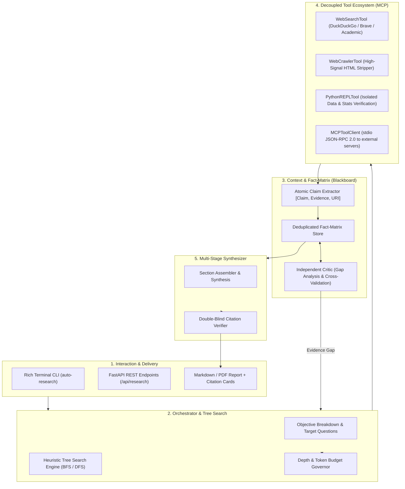

# 🔬 Auto-Research: Industrial-Grade Autonomous Deep Research Agent

[](https://www.python.org/downloads/)
[](https://opensource.org/licenses/MIT)
[](https://github.com/astral-sh/ruff)
[](https://modelcontextprotocol.io)

**Auto-Research** is an industrial-grade autonomous deep research agent inspired by the architecture of modern AI pair-programmers and deep research engines (such as Claude Code and OpenAI Deep Research).

Unlike naive "search + summarize" toy wrappers that suffer from severe context bloat and hallucinated citations, Auto-Research treats research as an **iterative hypothesis tree search** backed by a **structured Fact-Matrix (Blackboard)** and **tool decoupling via the Model Context Protocol (MCP)**.

---

## 🏛️ System Architecture



---

## ✨ Key Architectural Innovations

### 1. 🗄️ Atomic Fact-Matrix (Blackboard Pattern)
Rather than blindly appending full-length web pages and research papers into LLM prompt contexts (which inevitably causes context explosion and "Lost in the Middle" attention degradation), Auto-Research parses every source into **atomic triples**:
$$\text{Claim} \longleftrightarrow \text{Exact Evidence Snippet} \longleftrightarrow \text{Source URI}$$
The core orchestrator reasons over this deduplicated blackboard, drastically cutting token waste and ensuring that every single sentence in the final report maps back to a verifiable quote.

### 2. 🌲 Heuristic Tree Search & Depth Governor
Research naturally diverges into sub-problems. The `TreeSearchEngine` dynamically expands high-priority exploration branches, discovers sub-hypotheses, and tracks exploration depth. The **Depth Governor** halts branches that hit diminishing returns, preventing runaway spending or infinite recursive loops.

### 3. 🛡️ Tool Decoupling via MCP (Model Context Protocol)
Built from the ground up to support the **Model Context Protocol (MCP)** over `stdio` JSON-RPC 2.0. You can plug in:
- arXiv / Semantic Scholar MCP servers for academic literature.
- Playwright MCP for anti-bot scraping and JavaScript-heavy pages.
- Postgres / ClickHouse / BigQuery MCP for private enterprise data lakes.

### 4. 🔍 Independent Critic & Anti-Hallucination Audit
Before report assembly, an independent `ResearchCritic` agent evaluates the collected body of evidence:
- **Gap Analysis**: Identifies remaining blind spots and generates targeted queries.
- **Double-Blind Citation Verification**: Validates that all references strictly link to real, extracted citations in the Fact-Matrix, rejecting unsubstantiated claims.

---

## 📁 Repository Structure

```
auto-research/
├── auto_research/
│   ├── core/
│   │   ├── models.py           # Pydantic data contracts (Objective, FactMatrix, Node, Report)
│   │   ├── fact_matrix.py      # Blackboard pattern, deduplication & conflict detection
│   │   ├── tree_search.py      # Heuristic tree search & depth governor
│   │   ├── critic.py           # Gap analysis & citation verification
│   │   └── orchestrator.py     # Main Agentic closed loop coordinator
│   ├── tools/
│   │   ├── base.py             # Tool abstract base class & ToolResult
│   │   ├── search_tool.py      # Web search interface
│   │   ├── crawler_tool.py     # High-signal HTML cleaner & paragraph extractor
│   │   ├── code_runner.py      # Python REPL sandbox for calculation & data verification
│   │   └── mcp_client.py       # MCP client (stdio JSON-RPC 2.0 connector)
│   ├── synthesizer/
│   │   └── report_generator.py # Multi-stage report assembler & citation binder
│   ├── cli.py                  # Rich terminal interactive CLI
│   └── api.py                  # FastAPI server for headless/web deployments
├── examples/
│   └── quickstart.py           # Python API runnable script
├── tests/
│   └── test_core.py            # Pytest test suite
├── pyproject.toml              # Modern Python packaging configuration
├── requirements.txt            # Dependency specification
└── README.md
```

---

## 🚀 Quickstart

### 1. Installation

```bash
# Clone the repository
git clone https://github.com/Ruinan-Li/auto-research.git
cd auto-research

# Install dependencies
pip install -r requirements.txt
pip install -e .
```

### 2. Interactive CLI Mode

Launch an autonomous deep investigation directly from your terminal:

```bash
# Basic usage
auto-research "Solid-State Battery Commercialization Roadblocks"

# Advanced usage with custom sub-questions and round caps
auto-research "AI Agent Context Compaction" \
  -q "How does microcompacting work?" "What are prompt cache break pitfalls?" \
  -r 4 \
  -o "agent_compaction_report.md"
```

### 3. Python API Integration

```python
import asyncio
from auto_research.core.models import ResearchObjective, SearchDepth
from auto_research.core.orchestrator import ResearchOrchestrator

async def main():
    objective = ResearchObjective(
        topic="SMR (Small Modular Reactor) Nuclear Economics",
        target_questions=[
            "What is the levelized cost of energy (LCOE) compared to conventional nuclear?",
            "What are regulatory approval timelines in the US and Europe?",
        ],
        depth=SearchDepth.STANDARD,
        max_rounds=3,
    )

    orchestrator = ResearchOrchestrator(
        on_progress=lambda msg: print(f"[STATUS] {msg}")
    )
    report = await orchestrator.run(objective)
    
    # Export report to markdown
    print(report.to_markdown())

if __name__ == "__main__":
    asyncio.run(main())
```

### 4. Running the Web API Server

```bash
uvicorn auto_research.api:app --host 0.0.0.0 --port 8000
```

- `POST /api/research`: Submit a new research objective.
- `GET /api/research/{job_id}`: Poll live status and exploration logs.
- `GET /api/research/{job_id}/markdown`: Retrieve the completed structured research deliverable.

---

## 🧪 Testing

Run the full test suite with:

```bash
pytest tests/ -v
```

---

## 📜 License

MIT License. Developed by [Ruinan-Li](https://github.com/Ruinan-Li).
